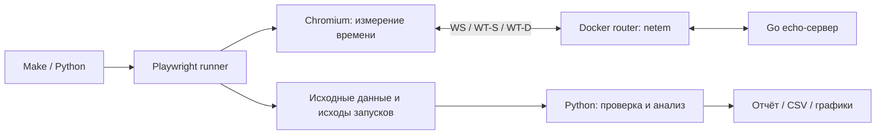

# WS / WebTransport benchmark

Локальный стенд для сравнения **WebSocket (WS)**, **WebTransport stream (WT-S)** и **WebTransport datagram (WT-D)** в Chromium при заданных задержках и потерях сети.

Он помогает оценить задержку ответа, долю ответов в пределах дедлайна и отсутствие ответа. Каждый запуск сохраняет исходные наблюдения, параметры среды и ошибки; Python строит отчёты, таблицы и графики.

## Как работает стенд



Браузер отправляет кадры по 256 байт с частотой 20 Гц. Сервер возвращает их без изменения. Время измеряет сама страница через `performance.now()`. Маршрутизатор задаёт условия в обоих направлениях; контейнеры работают во внутренних сетях без опубликованных портов.

| Параметр | Значение |
|---|---|
| Режимы | WS, WT-S, WT-D |
| Сетевые профили | Добавленный RTT 20 / 80 мс × потери 0 / 1% на направление; 10 Мбит/с |
| Один запуск | 200 прогревочных + 1200 измерительных слотов, шаг 50 мс |
| Основная серия | 20 блоков × 4 профиля × 3 режима = 240 последовательных запусков в 4 сессиях |
| Воспроизводимость | Заранее фиксированные порядок и seeds, снимки исходников и среды, SHA-256 |

## Что измеряется

| Метрика | Смысл |
|---|---|
| **Q** | p95 RTT ответов, полученных до горизонта 5000 мс; `null`, если ответов нет |
| **S** | Доля всех измерительных слотов с ответом до дедлайна 100 мс |
| **U** | Доля всех измерительных слотов без ответа до горизонта 5000 мс |

Дедлайн и горизонт отсчитываются от **планового времени слота**. Лаг отправки не вычитается; пропущенные слоты, поздние ответы и ошибки сохраняются. Неизвестные данные оборванного запуска не считаются измеренной потерей. Подробности — [метрики](docs/metrics.md) и [протокол](docs/protocol.md).

## Быстрый старт

Нужны Docker Compose, Make, Git и Python 3 на хосте. Закреплённая сборка требует **native Linux ARM64**; текущий допуск рассчитан на Docker VM с 2 vCPU и 4 ГБ памяти. Подсети `172.28.10.0/24` и `172.28.20.0/24` должны быть свободны.

Из корня репозитория:

```sh
make build                 # четыре образа, проверки TypeScript и Go
make smoke                 # TLS, совместимость транспортов и сетевой путь
make measurement-smoke     # короткое измерение WS / WT-S
```

Для новой серии следуйте [инструкции запуска](docs/run.md): создайте общий TLS-сертификат, измерьте фактическую среду коротким запуском и подготовьте каталог серии через `make exploratory-prepare`.

**Основной сбор запускается отдельно и может занять до 15 часов.** После подготовки, в той же оболочке с заданными `SERIES` и `SERIES_TLS_DIR`:

```sh
# macOS; на Linux уберите caffeinate -ims
caffeinate -ims make experiment SERIES_DIR="$SERIES" ALLOW_REAL_EXPERIMENTS=yes
```

Та же команда продолжает оставшиеся назначения после прерывания. Отдельные отказы сохраняются без повторов и добора; общая неисправность среды или неудачная очистка останавливает серию. Для длительного запуска на Mac нужны питание, открытая крышка и минимум 10 ГБ свободного места на хосте и в VM.

## Результаты и проверки

Отчёт создаётся автоматически в `SERIES/derived/report.md`. Рядом находятся JSON, CSV с RTT и лагом, графики PNG/SVG/PDF. Повторный анализ:

```sh
make analyze SERIES=results/main/experiment-001
```

Все назначения, включая отклонённые, оборванные и незапущенные, отражаются в отчёте. Полная валидная серия позволяет парное сравнение WT-S−WS по четырём профилям; WT-D описывается отдельно. Подробнее — [анализ](docs/analysis.md) и [устройство результатов](results/README.md).

Проверки отдельных частей: `make docker-test`, `make analysis-test`, `make acceptance-test`, `make controller-test`. Их охват и ограничения описаны в [документации проверок](docs/verification.md).

## Навигация

| Каталог | Назначение |
|---|---|
| [src/](src/README.md) | Клиент, сервер, управление браузером и анализатор |
| [configs/](configs/README.md) | План, сетевые профили, пороги, протокол, политики и JSON-схемы |
| [docker/](docker/README.md) | Образы, сценарии запуска, сеть и диагностика |
| [docs/](docs/README.md) | Подробное описание измерений, запуска и анализа |
| [results/](results/README.md) | Основные серии, проверочные запуски и архивы |
| [.github/](.github/README.md) | Автоматические проверки в GitHub Actions |

`build/` — локальные зависимости, сборочные свидетельства и TLS-ключи; каталог исключён из Git и создаётся инструментами стенда.
